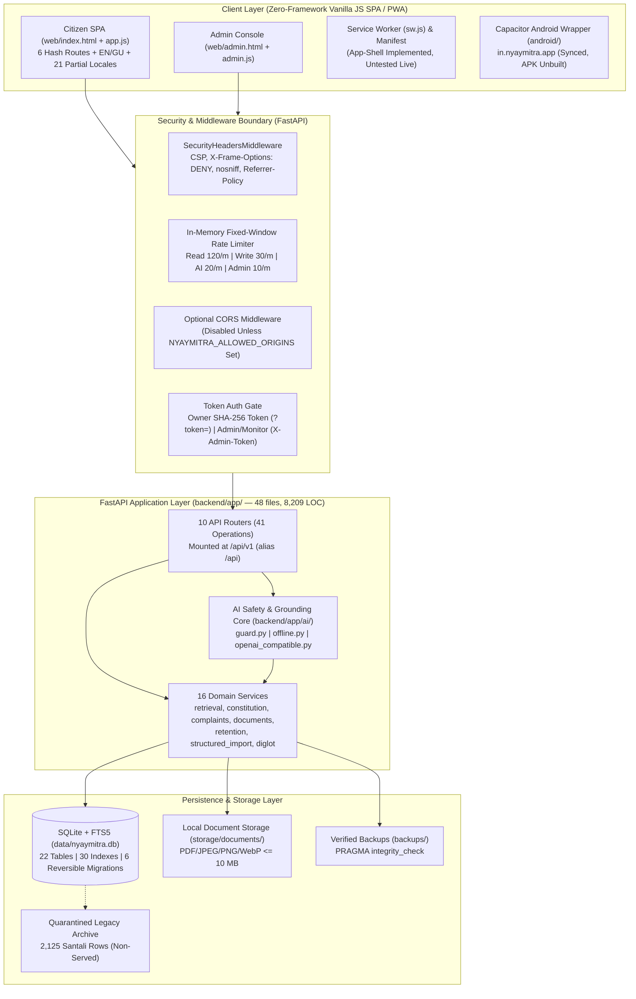
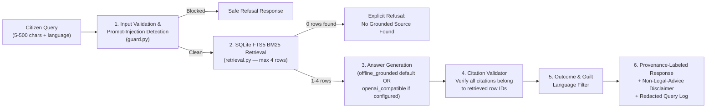

# NYAYMITRA 2.0 — System Architecture Documentation

**Project:** NYAYMITRA 2.0  
**Developed by:** Divyesh Bambhaniya  
**Repository:** [dhundhwana-arch/Nyaymitra-2.0](https://github.com/dhundhwana-arch/Nyaymitra-2.0/tree/arena/2497125a-nyaymitra-2-0)  
**Canonical Branch:** `arena/2497125a-nyaymitra-2-0`  
**Verified Handover Commit:** `9b2ee1f49b70ca2cc8ebafa2f017f7e24cdeee4a`  

---

## 1. High-Level System Architecture

NYAYMITRA 2.0 is a modular, offline-capable web platform designed for low-bandwidth citizen access to legal information, constitutional articles, government department routing, and privacy-preserving complaint drafting. It avoids heavy frontend frameworks, external CDNs, and mandatory cloud dependencies.

---

## 2. Core System Components

| Layer | Repository Path | Verified Scale | Responsibilities |
| :--- | :--- | :--- | :--- |
| **Citizen Frontend** | `web/` | 45 files, 1,636 JS lines | Zero-CDN Vanilla JS SPA (`index.html`, `app.js`, `styles.css`, `config.js`), 6 hash routes (`#/home`, `#/assistant`, `#/complaint`, `#/library`, `#/departments`, `#/glossary`), 23 locale JSON files (`web/locales/`), 10 PWA icons, `sw.js`, `manifest.webmanifest` |
| **Admin Console** | `web/admin.html`, `web/admin.js` | Included in `web/` | Token-authenticated operator UI for stats, verification queue, redacted queries, errors, metadata-only complaints/documents, legacy rows, and integrity-checked backups |
| **FastAPI Core** | `backend/app/` | 48 files, 8,209 LOC | `main.py`, `config.py`, `middleware.py`, `security.py`, `logging_config.py`, `metrics.py`, `seed.py`, 10 routers (`routers/`), 16 services (`services/`), schemas (`schemas/`), AI layer (`ai/`) |
| **Database Migrations** | `backend/migrations/` | 12 SQL files (6 up/down pairs) | Reversible schema evolution (`001_initial` through `006_article_text_normalized`) |
| **Ingestion & CLI Tools** | `ingestion/`, `scripts/` | 18 scripts | DB initialization (`init_db.py`), integrity check (`check_db.py`), backups (`backup_db.py`), PII purge (`purge_data.py`), Constitution import (`import_constitution_data.py`), locale auditing (`audit_locales.py`, `build_locales.py`, `language_matrix.py`), jsdom E2E (`e2e_activation.mjs`) |
| **Mobile Wrapper** | `android/`, `capacitor.config.js` | 53 files | Capacitor project (`in.nyaymitra.app`) synced with `web/`; APK not yet built |
| **Legacy Prototype** | `frontend/legacy/` | 6 files (5.2 MB) | Superseded prototype (includes `library_fix.js` 4.9 MB) retained strictly for historical reference |

---

## 3. API Architecture (`/api/v1`)

All API operations are registered across 10 routers in `backend/app/routers/` (41 operations total), mounted at `/api/v1` (with an unlisted `/api` alias). Machine-readable schema is exposed at `GET /api/openapi.json`; interactive Swagger (`/api/docs`) and ReDoc (`/redoc`) are disabled by design.

| Router Module | Key Endpoints | Auth Model | Primary Function |
| :--- | :--- | :--- | :--- |
| `health.py` | `GET /health`, `GET /ready`, `GET /meta` | Public | Liveness, readiness (DB/migrations/storage/AI), corpus counts & UI disclaimers |
| `constitution.py` / `library.py` | `GET /constitution/articles`, `GET /constitution/articles/{id}`, `GET /constitution/articles/{no}/text?lang=`, `GET /constitution/parts`, `GET /constitution/coverage` | Public | FTS5 article search, individual article retrieval, multilingual text lookup, coverage transparency |
| `languages.py` | `GET /languages`, `GET /languages/{code}`, `POST /languages/detect` | Public | Language availability matrix, metadata, and script/language detection |
| `ai.py` | `POST /ai/explain`, `POST /ai/terminology`, `GET /ai/glossary` | Public | Grounded legal Q&A, legal term explanations, 18-term glossary |
| `complaints.py` | `POST /complaints/preview`, `POST /complaints`, `GET /complaints/{reference}?token=` | Public write; Owner token read | Deterministic preview, consent-gated submission (`confirmed: true`), zero-oracle owner lookup |
| `documents.py` | `POST /documents`, `GET /documents/{id}?token=`, `GET /documents/{id}/content?token=` | Public write; Owner token read | Multipart upload (PDF/JPEG/PNG/WebP ≤ 10 MB, magic-byte validated), owner metadata & byte download |
| `departments.py` | `GET /departments`, `GET /departments/{department_key}` | Public | 11 seeded government/legal-aid authorities with jurisdiction & verification metadata |
| `feedback.py` | `POST /feedback` | Public | User feedback capture on AI answers and content |
| `admin.py` | `GET /admin/{stats,verification-queue,queries,answers,errors,audit,complaints,documents,sources,metrics,legacy-chunks}`, `PATCH /admin/articles/{id}/verification`, `POST /admin/backup` | `monitor` (GET), `admin` (PATCH/POST) via `X-Admin-Token` or `Bearer` | Operational telemetry, privacy-filtered inspection, human verification workflow, and SQLite backups |

---

## 4. AI & Grounded Retrieval Pipeline

NYAYMITRA 2.0 enforces a strict **retrieve-first, refuse-if-ungrounded** pipeline across `backend/app/ai/guard.py`, `backend/app/services/retrieval.py`, `backend/app/ai/offline.py`, and `backend/app/ai/openai_compatible.py`:

- **Zero Hallucinated Citations:** Any citation not present in the retrieved FTS5 set (max 4 rows) is rejected.
- **Offline Determinism:** Because no live LLM API key is configured in default/sandbox runs (`NYAYMITRA_AI_FALLBACK_MODE=offline_grounded`), the deterministic offline grounded responder ensures predictable, verifiable behavior without external network calls.
- **Live LLM Status:** `openai_compatible.py` is implemented and tested against a local stub HTTP server, but **not yet tested against a live production LLM provider**.

---

## 5. Database Architecture (SQLite + FTS5)

The database (`data/nyaymitra.db`) uses SQLite 3.40+ with FTS5 full-text search, containing **22 tables** and **30 indexes** managed through **6 reversible migration pairs** (`001`–`006`):

| Domain | Verified Tables | Purpose |
| :--- | :--- | :--- |
| **Legal Corpus & Search** | `constitution_articles`, `constitution_fts` (FTS5), `article_sources`, `legal_sources`, `triage_guides`, `departments`, plus `003` source pages & `005`/`006` multilingual normalized article texts | Grounded legal retrieval, provenance tracking, verification flags, and department routing |
| **Citizen Workflows** | `complaints`, `documents` | Consent-gated complaint records (SHA-256 owner token hash, idempotency via `002`) and validated document metadata |
| **AI & Observability** | `ai_answers` (with `prompt_tokens`/`completion_tokens` from `004`), `query_logs` (redacted text + hash), `feedback`, `error_log`, `audit_log` | Provenance logging, redacted analytics, error tracking, and audit trail |
| **Ingestion & Quarantine** | `ingest_runs`, `legacy_import_chunks` | Tracks structured ingestion runs and isolates 2,125 quarantined legacy Santali rows away from citizen search |

---

## 6. Security Boundaries & Trust Zones

1. **Browser ↔ FastAPI Boundary:** Enforces `SecurityHeadersMiddleware` (strict CSP with no inline scripts/`eval`, `X-Frame-Options: DENY`, `X-Content-Type-Options: nosniff`, `Referrer-Policy: no-referrer`), body-size caps (512 KB JSON / 10 MB uploads), `textContent`-only DOM rendering (no `innerHTML`), and per-IP fixed-window rate limiting.
2. **Citizen Privacy Boundary:** Citizen complaints and uploaded documents are protected by one-time high-entropy owner tokens stored only as SHA-256 hashes. Wrong tokens return generic `404` responses (preventing enumeration).
3. **Admin Isolation Boundary:** `monitor` (read-only) and `admin` (mutating) tokens are compared in constant time via `X-Admin-Token` / `Authorization: Bearer`. Administrators see complaint and document **metadata only**—never citizen descriptions, contact details, or raw document contents.
4. **Production Preflight Gate:** In `NYAYMITRA_ENV=production`, `create_app()` blocks startup if tokens are missing/weak/identical, if the SQLite file is inside the Git checkout, or if proxy headers are trusted without explicit `NYAYMITRA_ALLOWED_ORIGINS`.
